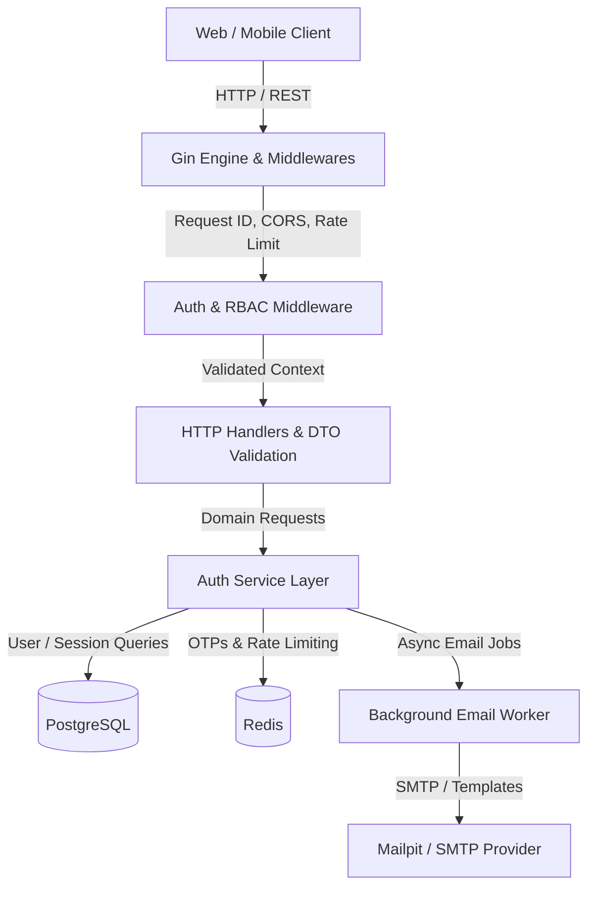
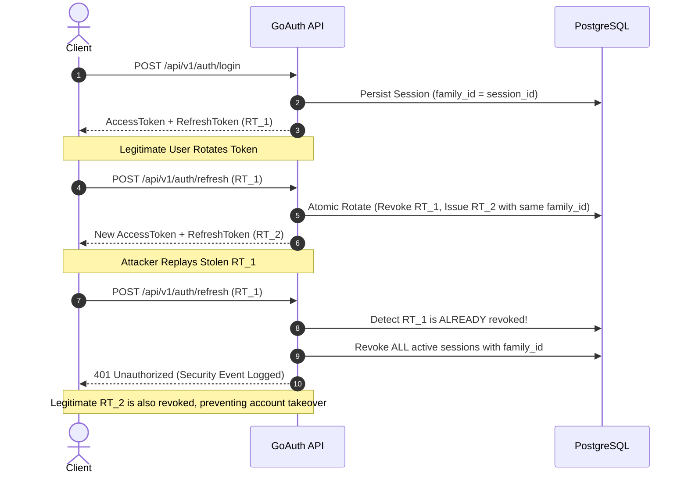

# GoAuth 🛡️ — Production-Ready Go Authentication Template

[](https://github.com/paranietharan/GoAuth/actions/workflows/ci.yml)
[](https://goreportcard.com/report/github.com/paranietharan/GoAuth)
[](https://opensource.org/licenses/MIT)

**GoAuth** is a battle-tested, modular, CV-worthy authentication and session management foundation engineered specifically for **monolithic Go APIs**. Built with clean architecture principles, it eliminates repetitive auth boilerplate while delivering bank-grade security out of the box.

---

## 🌟 Key Features

- **🔐 Token Lifecycle & Reuse Detection**: Short-lived HS256 JWT access tokens paired with SHA-256 hashed refresh tokens. Employs **Token Family** tracking; if an expired or previously rotated token is re-submitted, descendant sessions are immediately revoked to protect against token hijacking.
- **⚡ Race-Condition Proof Rotation**: Atomic conditional updates (`UPDATE sessions ... WHERE id = $1 AND is_revoked = FALSE`) prevent concurrency vulnerabilities when multiple frontend calls refresh tokens simultaneously.
- **🛡️ Distributed Sliding-Window Rate Limiting**: Redis-backed rate limiting on sensitive routes (`/login`, `/signup`, `/forgot-password`) with graceful in-memory fallback.
- **👥 Role-Based Access Control (RBAC)**: Type-safe role assertions (`USER`, `ADMIN`) with declarative Gin middlewares and context propagation.
- **🪵 Structured Observability (`slog`)**: JSON and human-readable structured logs with automatic masking of sensitive attributes (`password`, `access_token`, `refresh_token`, `otp`). Includes dedicated `SECURITY_AUDIT` logging.
- **🩺 Health & Readiness Probes**: Kubernetes/Docker-ready `/health` (liveness) and `/ready` (PostgreSQL and Redis dependency ping).
- **✉️ Asynchronous Transactional Email Worker**: Non-blocking email delivery pool with graceful shutdown draining via `sync.WaitGroup`. Integrated with **Mailpit** for local SMTP debugging.
- **🐳 Multi-Stage Docker & Compose**: 100% environment-driven setup without hardcoded fallback values.

---

## 📐 System Architecture

### 1. Layered Clean Architecture


### 2. Refresh Token Rotation with Token Family Reuse Detection


---

## 🚀 How to Reuse in Your Monolithic Go API

Integrating GoAuth's authentication into another Gin project takes under 5 minutes:

### Step 1: Copy `internal/middleware` and `internal/model`
Import the middleware in your monolithic service:
```go
import (
    "GoAuth/internal/middleware"
    "GoAuth/internal/model"
)
```

### Step 2: Initialize Auth Middleware in your Host Router
```go
authMiddleware := middleware.NewAuthMiddleware(
    cfg.JWTSecret,
    sessionRepo, // implements repository.SessionRepository
    userRepo,    // implements repository.UserRepository
)
```

### Step 3: Secure Your Custom Domain Routes
```go
api := r.Group("/api/v1")

// 1. Public catalog endpoint
api.GET("/catalog", listCatalogHandler)

// 2. Protected user endpoint (Requires valid JWT and active session)
orders := api.Group("/orders")
orders.Use(authMiddleware.RequireAuth())
{
    orders.POST("", func(c *gin.Context) {
        userID := c.GetString("user_id")       // Extracted from claims
        userEmail := c.GetString("user_email") // Extracted from claims
        // Create order for user...
    })
}

// 3. Admin-only endpoint (Requires ADMIN role)
admin := api.Group("/admin")
admin.Use(authMiddleware.RequireAuth(), middleware.RequireRoles(model.RoleAdmin))
{
    admin.GET("/metrics", metricsHandler)
}
```

See [examples/monolith/main.go](examples/monolith/main.go) for a runnable, end-to-end example.

---

## 🛠️ Quickstart with Docker Compose

### 1. Clone & Setup Environment
```bash
git clone https://github.com/paranietharan/GoAuth.git
cd GoAuth
cp .env.example .env
```

### 2. Boot Services
```bash
docker compose up -d --build
```
This automatically boots:
- **GoAuth API** at `http://localhost:8080`
- **PostgreSQL 16** at `localhost:5432`
- **Redis 7** at `localhost:6380`
- **Mailpit Web UI** at `http://localhost:8026` (SMTP port `1026`)

### 3. Verify Health
```bash
curl http://localhost:8080/health
curl http://localhost:8080/ready
```

---

## 🧪 Developer Workflow & Makefile

A standard `Makefile` is provided for all development tasks:

| Command | Description |
| :--- | :--- |
| `make build` | Compiles `bin/server` and `bin/migrate` |
| `make run` | Starts the GoAuth server locally |
| `make migrate-up` | Applies all pending PostgreSQL migrations |
| `make migrate-down` | Rolls back the latest database migration |
| `make seed` | Populates database with default admin user |
| `make test` | Runs unit tests across all packages |
| `make test-race` | Runs entire test suite with Go data race detector (`-race`) |
| `make test-integration` | Executes end-to-end integration tests |
| `make docker-up` | Starts full Docker Compose stack |
| `make docker-down` | Stops and removes Docker Compose containers |

---

## 🔒 Security Design Decisions

1. **Why SHA-256 Hash Refresh Tokens?**
   Storing refresh tokens in plaintext means a database read leak compromises all active sessions. Hashing tokens with SHA-256 ensures database access alone cannot forge a refresh request.
2. **Short-Lived Access Tokens (15 Minutes)**:
   JWTs cannot be revoked without state lookups. GoAuth pairs short access token lifetimes (15m) with fast local signature checks and database session confirmation for zero-trust authorization.
3. **Algorithm Downgrade Prevention**:
   JWT parser enforces `jwt.WithValidMethods([]string{"HS256"})`. Tokens crafted with `none` or asymmetric public key spoofing are rejected immediately.
4. **Immediate Deactivation Revocation**:
   When an admin marks a user inactive (`is_active = false`), all active sessions are revoked instantly and `AuthMiddleware` denies existing access tokens immediately.

---

## 📖 API Documentation & `curl` Examples

A full OpenAPI 3.0 specification is available at [`docs/openapi.yaml`](docs/openapi.yaml). For an extensive testing walkthrough covering all endpoints, payloads, status codes, and security attack simulations, refer to the [**API Testing Guide**](docs/API_TESTING.md).

### 1. Register a New User
```bash
curl -X POST http://localhost:8080/api/v1/auth/signup \
  -H "Content-Type: application/json" \
  -d '{"email":"alice@example.com","password":"StrongPassword123!"}'
```

### 2. Verify Email with OTP
Open Mailpit UI (`http://localhost:8026`) to view your 6-digit OTP:
```bash
curl -X POST http://localhost:8080/api/v1/auth/verify-email \
  -H "Content-Type: application/json" \
  -d '{"email":"alice@example.com","otp":"123456"}'
```

### 3. Login
```bash
curl -X POST http://localhost:8080/api/v1/auth/login \
  -H "Content-Type: application/json" \
  -d '{"email":"alice@example.com","password":"StrongPassword123!"}'
```
Response:
```json
{
  "access_token": "eyJhbGciOiJIUzI1Ni...",
  "refresh_token": "a1b2c3d4...",
  "user": {
    "id": "3d4abf39-5719-42d6-8cdb-3e352351f1a1",
    "email": "alice@example.com",
    "role": "USER",
    "is_active": true,
    "is_email_verified": true
  }
}
```

### 4. Access Protected Route
```bash
curl http://localhost:8080/api/v1/users/me \
  -H "Authorization: Bearer <ACCESS_TOKEN>"
```

### 5. Rotate Refresh Token
```bash
curl -X POST http://localhost:8080/api/v1/auth/refresh \
  -H "Content-Type: application/json" \
  -d '{"refresh_token":"<REFRESH_TOKEN>"}'
```

### 6. Logout from All Devices
```bash
curl -X POST http://localhost:8080/api/v1/auth/logout-all \
  -H "Authorization: Bearer <ACCESS_TOKEN>"
```

---

## 📁 Repository Directory Structure

```text
GoAuth/
├── .github/workflows/ci.yml       # GitHub Actions CI pipeline
├── cmd/server/main.go             # Application entrypoint & graceful shutdown
├── database/
│   ├── cmd/main.go                # CLI migration & seed runner
│   ├── migrations/                # Versioned SQL .up.sql and .down.sql migrations
│   └── runner/                    # Migration engine
├── docs/
│   ├── openapi.yaml               # OpenAPI 3.0 specification
│   ├── API_TESTING.md             # Complete endpoint testing guide with curl commands
│   ├── ENV.md                     # Complete environment variables guide
│   └── MIGRATIONS.md              # Database migration documentation
├── examples/monolith/main.go      # Reusable monolith integration example
├── internal/
│   ├── config/                    # Strict config loading & validation
│   ├── database/                  # PostgreSQL & Redis pool connections
│   ├── dto/                       # Request/Response data transfer objects
│   ├── errors/                    # Unified error codes & JSON envelopes
│   ├── handler/                   # HTTP controller handlers
│   ├── logger/                    # Structured slog with secret masking & audit
│   ├── middleware/                # Auth, RBAC, Rate-Limiting, CORS, Recovery
│   ├── model/                     # Domain models (User, Session, Role)
│   ├── notification/email/        # SMTP provider & HTML email templates
│   ├── repository/                # Data access layers (Postgres & Redis)
│   ├── router/                    # Route registration & rate limiting bounds
│   ├── service/                   # Core authentication business logic
│   └── worker/                    # Asynchronous email worker pool
├── tests/integration/             # Full lifecycle integration tests
├── Makefile                       # Developer automation targets
├── Dockerfile                     # Multi-stage production build
└── compose.yaml                   # Production-grade multi-service stack
```

---

## 📄 License
This project is licensed under the [MIT License](LICENSE).